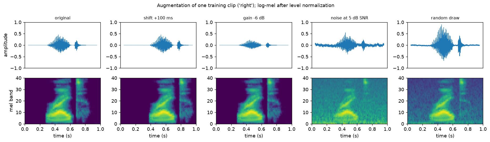
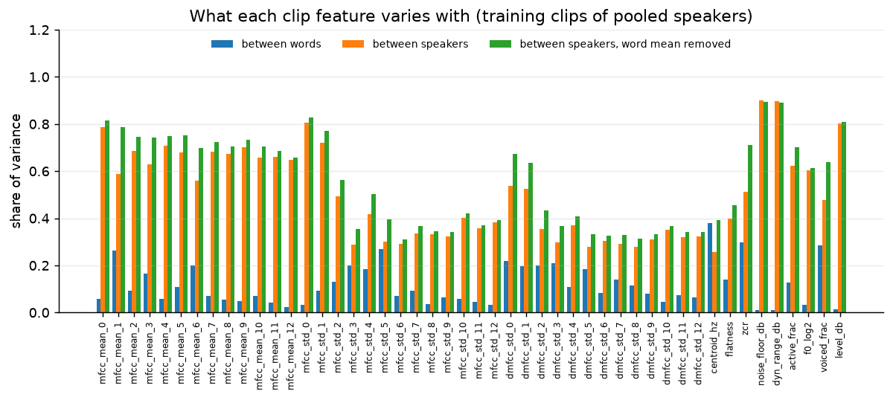
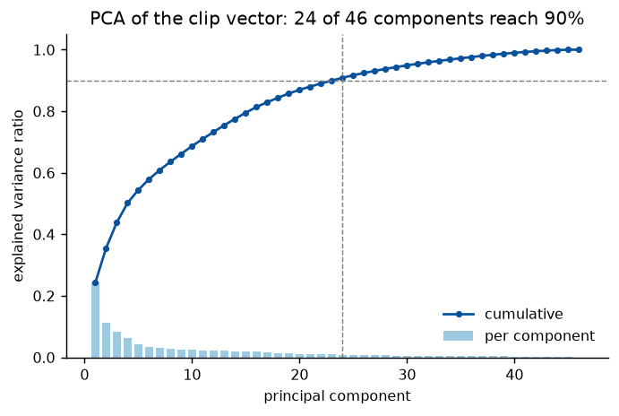
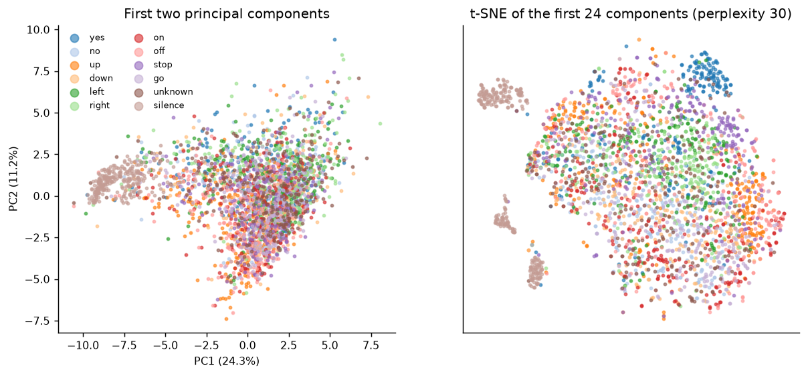
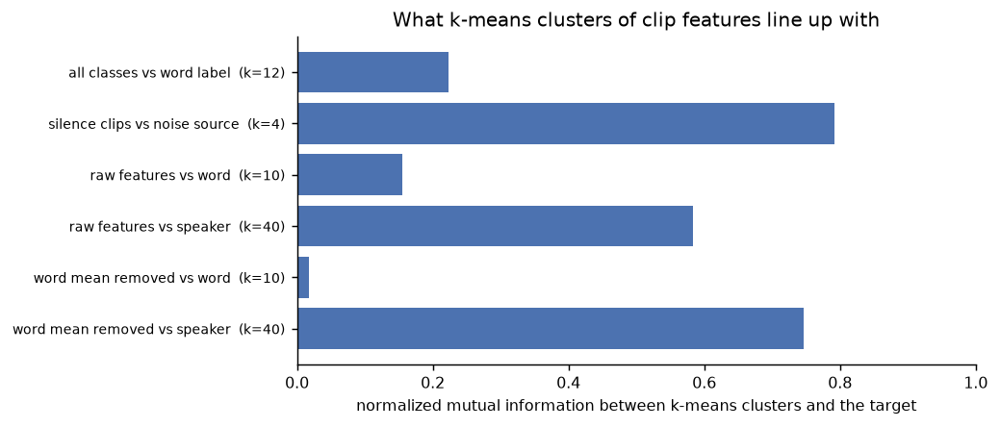
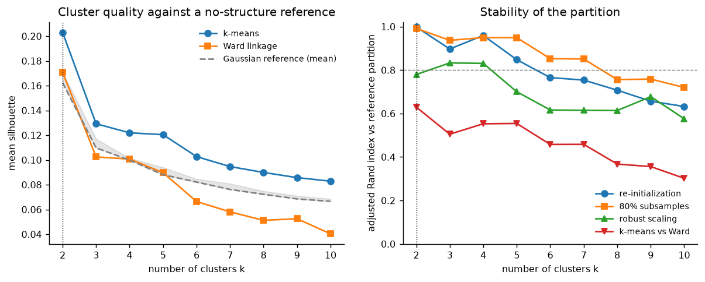
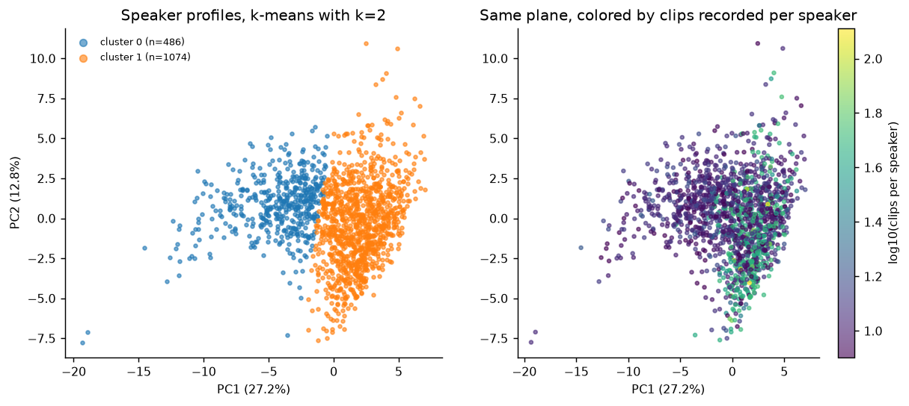
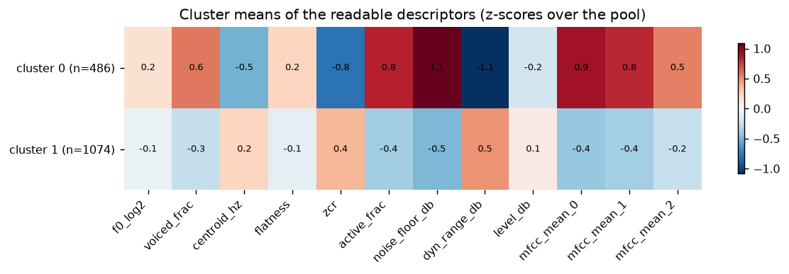
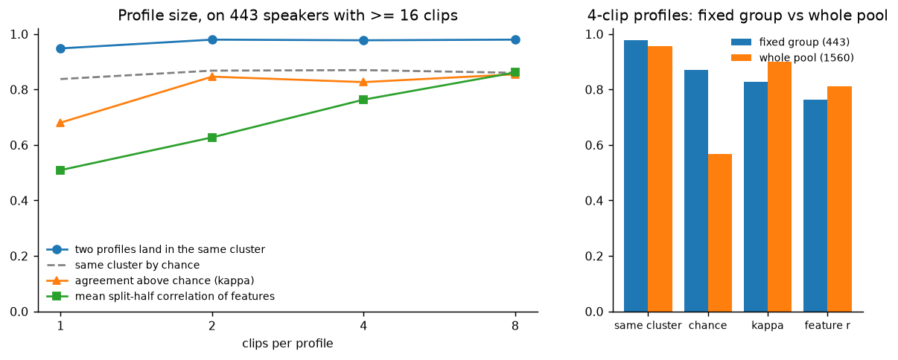

# Phase 2 Report — Data Preparation, Feature Engineering and Speaker Structure

**Project:** Data Economics of Keyword Spotting — Smarter Speaker Selection vs. Random Sampling <br>
**Route:** D — Google Speech Commands, audio analysis and KWS <br>
**Student:** SeyedHossein AhmadiMousavi <br>
**Student ID:** 402100334 <br>
**Repository:** https://github.com/sham0501/kws-speaker-economics — tag `phase-2` <br>
**Date:** 2026/11/20 <br>

---

## 1. What this phase had to deliver

Phase 3 trains many small models on subsets of speakers chosen in different ways. Before
that can start, three things have to exist and be trustworthy:

1. **One prepared version of every clip**, built once, with every choice recorded, so
   that every model in phase 3 sees the same input and nothing about preparation
   differs between strategies.
2. **A description of each candidate speaker** that a collecting team could actually
   obtain before deciding whom to record in full, together with what obtaining it costs.
3. **An answer to whether those descriptions have structure** that a selection rule can
   use, and how much that answer can be trusted.

The phase-1 findings shaped all three: speakers are split into occasional and prolific
contributors (phase-1 report, section 7.4), loudness varies far more across recordings
than across words (section 7.3), and the silence class is a few reused recordings
(section 6). Every number below is read from a file in `reports/phase2/`; Appendix B
lists them.

---

## 2. Preparation pipeline

`src/features/build_features.py` runs the following steps on all 46,254 clips of the
manifest. Row *i* of every output array is row *i* of `data/subset_manifest.csv`.

| Step | What is done | Result on this data |
|---|---|---|
| Length | zero-pad at the end to 16,000 samples; longer clips would keep their first 16,000 | 4,007 clips padded, 0 cropped; shortest clip 4,778 samples (0.30 s) |
| Level measurement | RMS of the recording itself, padding excluded; kept as `level_db` | — |
| Level normalization | scale every clip to RMS 0.05, gain capped at +30 dB | applied gain: median −1.7 dB, 5th–95th percentile −11.5 to +11.6 dB; 176 clips reach the cap, all of them `silence` |
| Log-mel | 40 mel bands, 20–7,600 Hz, 25 ms window, 10 ms hop | 98 frames per clip |
| Clip vector | 48 summary values per clip (section 4) | statistics use only frames inside the recording |

Two decisions in this table need a reason.

**Why level normalization, and why measured without the padding.** Phase 1 showed that
loudness says almost nothing about which word was said but a lot about the microphone,
and that three of the four train silence recordings are 10 to 150 times quieter than the
test one.
A model that sees raw level can learn a shortcut that inverts at test time. Normalizing
removes the shortcut; the original level is kept as a separate value (`level_db`) for
describing speakers, and is never given to a word classifier. The RMS is measured on the
recorded samples only: measuring it on the padded clip would make a short clip look
quieter than it is and amplify it more, so the same recording would be prepared
differently depending on how much padding it needed.

**Why statistics ignore the padding.** A clip vector built from all 98 frames would
count the padded frames as silence. A 0.5 s recording padded to 1 s would then appear to
be half silent, and its activity and voicing fractions would be halved. All clip
statistics are computed over frames that lie wholly inside the recording, and
`tests/test_padding_invariance.py` checks that padding a recording leaves its clip vector
unchanged.

The build stores a fingerprint of the manifest, the settings and the version of the
extraction code, and every later stage refuses a build that does not match. A build
removes its completion marker before overwriting any array and writes it back last, so a
build that is interrupted is refused rather than read as complete
(`tests/test_interrupted_build.py`). The full build took 124.5 s on 7 worker processes.

---

## 3. Augmentation



Three transforms are defined for training clips only (`reports/phase2/augmentation_settings.json`):

| Transform | Range | What it imitates |
|---|---|---|
| Time shift | uniform in ±100 ms, zero-filled | the word starting at a different point of the second |
| Gain | uniform in ±6 dB | the same voice at a different distance from the microphone |
| Added noise | with probability 0.5, SNR uniform in 5–20 dB | the same word in a noisier room |

They act on the raw waveform before level normalization, so an augmented clip passes
through exactly the same preparation as an original one. The noise is drawn only from the
four background recordings assigned to the training split; using `running_tap` or
`white_noise` would let the model hear the validation or test silence recording during
training. Augmentation is never applied to validation or test clips.

One consequence is worth stating plainly. Because the level is normalized after
augmentation, the gain transform on its own changes nothing: the largest difference it
produces in the log-mel of a clip is 5.7 × 10⁻⁶. It only has an effect for the few
clips that reach the gain cap and in the phase-4 sensitivity analysis that turns level
normalization off. It is kept so that the augmentation does not have to change between
those runs, not because it adds information here.

---

## 4. Feature catalog

The clip vector has 48 values in eight groups (`reports/phase2/feature_catalog.csv`). The
log-mel spectrogram itself is not stored; phase 3 computes it from the prepared waveform.

| Group | Values | What it adds | Used by |
|---|---|---|---|
| Log-mel spectrogram | 40 bands × 98 frames | the full time-frequency picture; the only representation that keeps the order of sounds inside the word | convolutional model |
| MFCC mean | 13 | the average spectral envelope: the dominant vowel shape plus the long-term coloring of voice and microphone | classical models, profiles |
| MFCC spread | 13 | how much the envelope moves within the clip; separates a steady sound from a word with several segments | classical models, profiles |
| Delta-MFCC spread | 13 | the speed of spectral change, which time averages discard; fast transitions mark stops such as the /p/ in "up" and "stop" | classical models, profiles |
| Spectral shape | centroid, flatness, zero-crossing rate | brightness and noisiness in readable units; flatness is near 1 for broadband noise and near 0 for voiced speech | classical models, profiles |
| Recording condition | noise floor, dynamic range, `level_db` | the channel rather than the voice: how noisy the room or microphone is and how loud the recording was | profiles only for `level_db` |
| Timing | active fraction | how much of the second is occupied by sound; a proxy for word length and speaking rate | classical models, profiles |
| Voicing and pitch | f0, voiced fraction | the one property of a voice that MFCCs deliberately smooth away | profiles (f0), classical models (voiced fraction) |

A word classifier sees 46 of the 48 values: `level_db` is left out because it describes
the microphone, and f0 because it is undefined when a clip has no voiced frame. That
happens for 2,964 clips: 2,691 of them `silence` (69.8% of the class), and among words
mostly `stop` (113, 2.9%) and `up` (50, 1.3%), the two keywords with a short vowel
followed by an unvoiced /p/. In profiles, pitch is averaged on a log scale over the
clips where it is defined; no profile ended up without a pitch value.

---

## 5. What the features vary with: the word or the speaker



Before building speaker profiles, each feature was split into the share of its variance
that lies between words and the share that lies between speakers, on the 31,948 spoken
training clips of the 1,560 speakers used later (`reports/phase2/feature_variance_shares.csv`).
A feature unrelated to the grouping would still show a share of about 0.001 between the
35 words and 0.049 between the speakers, simply from the number of groups.

| Average over the 48 features | Share of variance |
|---|---|
| between words | 0.116 |
| between speakers | 0.503 |
| between speakers, after removing each word's mean | 0.558 |

All features but one vary more between speakers than between words, most of them by a
wide margin; the exception is the spectral centroid (0.38 between words, 0.26 between
speakers). The features most tied to the speaker are the recording-condition ones, noise
floor and dynamic range (0.90 each), then the spread and mean of MFCC 0, the overall
log-energy envelope (0.81 and 0.79), and the recording level (0.80). The features most
tied to the word are the spectral centroid (0.38), the zero-crossing rate (0.30), the
voiced fraction (0.29), the spread of MFCC 5 (0.27) and the mean of MFCC 1 (0.26).

Two conclusions follow. Summary statistics of a clip are much better at telling who
recorded it than what was said, which is why the word classifier in phase 3 needs the
time-ordered log-mel rather than these statistics alone. And because the word does carry
a part of the variance, removing each word's mean before averaging raises the speaker
share of almost every feature; profiles are built that way (section 7).

---

## 6. Structure of the clip features

Three views of 6,000 training clips, 500 per class, all fitted on training data
(`reports/phase2/clip_structure.json`).



**Dimensionality.** 24 of the 46 classifier features' principal components are needed to
reach 90% of the variance; the first carries 24.3% and the second 11.2%. The variance is
spread over many directions, so a two-dimensional picture shows only about a third of it.



**What the projections show.** In the PCA plane, `silence` clips occupy their own region
at low PC1 and all the words overlap in one cloud. The t-SNE map (on the first 24
components) separates `silence` into a few compact islands, as expected from clips cut
from four recordings, and shows small groups of `yes` and `stop`; the other words are
mixed. t-SNE distances
between groups have no meaning, so the map is used only to see which neighborhoods are
pure.



**What k-means finds.** Each bar is the normalized mutual information (NMI) between a
k-means partition and one possible explanation of it:

| Partition | k | NMI | ARI |
|---|---|---|---|
| all classes, against the class label | 12 | 0.224 | 0.115 |
| silence clips, against the source recording | 4 | 0.792 | 0.721 |
| 40 prolific speakers' clips, against the word | 10 | 0.155 | 0.086 |
| the same clips, against the speaker | 40 | 0.583 | 0.280 |
| the same clips with the word mean removed, against the word | 10 | 0.018 | 0.005 |
| the same clips with the word mean removed, against the speaker | 40 | 0.746 | 0.520 |

The word and speaker comparisons use the keyword clips of 40 speakers drawn at random
among those with at least 40 keyword clips (1,877 clips), so that each speaker has enough
clips to form a group. Clusters of clip statistics follow the
speaker far more than the word, and after removing the word mean they carry almost no
word information and more speaker information. NMI and ARI depend on the number of
clusters, so the comparison between k = 10 and k = 40 is indicative rather than exact;
the change within each row pair, with and without the word mean, is the cleaner reading.
For silence, the clusters nearly recover the four recordings, which matches the
phase-1 finding that each recording is reused many times.

---

## 7. Speaker profiles from screening clips

The selection question is about *whom to record*. A profile may therefore use only what a
team could have before that decision: a few short "screening" recordings of each
candidate. The design (`configs/phase2.yaml`, `src/features/speaker_profiles.py`):

- **Candidates:** the 1,560 training speakers with at least 8 spoken clips (467 of the
  2,027 have fewer and are left out, so that every candidate can also supply training
  clips beyond the screening).
- **Screening:** 4 clips per candidate, drawn at random with the project seed; 6,240
  clips in total (`reports/phase2/screening_clips.csv`).
- **Word removal:** from every clip, the mean of its word is subtracted. The word means
  come from the 6,240 screening clips alone (35 words, at least 10 and a median of 30 clips
  per word), not from the whole training split, because a team screening candidates would
  not have the full archive.
- **Profile:** the mean of the 4 word-corrected clip vectors, 48 values per speaker
  (`reports/phase2/speaker_profiles.csv`).

Only training speakers are profiled and no validation or test clip enters any mean,
scaler or projection fitted in this phase.

---

## 8. Clustering the profiles

### 8.1 Dimensionality reduction

The 48 profile values are standardized, and principal components are kept up to 90% of
the variance: **22 components**, the first two carrying 27.2% and 12.8%. Clustering runs
on these 22 components, which removes near-duplicate directions (the MFCC coefficients
are correlated) without discarding most of the variance as a two- or three-dimensional
projection would.

### 8.2 Choosing k

k-means alone cannot answer whether speakers form groups: it always returns k clusters,
and its silhouette falls with k even on data with no groups at all. Each k from 2 to 10
was therefore compared with what the same procedure finds in Gaussian data with the same
component variances (20 reference sets, same k-means settings), and its stability was
measured in four ways (`reports/phase2/k_selection.csv`):

| k | Silhouette | Reference (mean / 95th pct.) | Excess | ARI seeds | ARI 80% subsamples | Smallest cluster |
|---|---|---|---|---|---|---|
| **2** | **0.203** | 0.162 / 0.171 | **0.041** | **0.998** | **0.992** | 486 |
| 3 | 0.129 | 0.110 / 0.117 | 0.020 | 0.897 | 0.937 | 447 |
| 4 | 0.122 | 0.100 / 0.102 | 0.022 | 0.959 | 0.950 | 158 |
| 5 | 0.120 | 0.088 / 0.094 | 0.032 | 0.848 | 0.949 | 117 |
| 6 | 0.103 | 0.082 / 0.085 | 0.021 | 0.766 | 0.853 | 109 |
| 7–10 | 0.083–0.095 | | 0.016–0.019 | 0.63–0.75 | 0.72–0.85 | |



**Rule, fixed before looking at the table:** among the k whose partition is stable under
re-initialization (mean ARI at least 0.8 over 20 seeds), take the one whose silhouette
exceeds the Gaussian reference by the widest margin. This gives **k = 2**. Its silhouette
(0.203) is above the 95th percentile of the reference (0.171), so the split is more than
a slicing of one cloud. k = 4 and k = 5 also pass the stability condition and exceed the
reference, by smaller margins (0.022 and 0.032).

### 8.3 How stable the partition is

| Check | ARI against the chosen partition |
|---|---|
| 20 other k-means initializations | 0.998 (minimum 0.995) |
| 20 subsamples of 80% of the speakers | 0.992 (minimum 0.982) |
| robust scaling (median and IQR) instead of standardization | 0.780 |
| Ward linkage instead of k-means | 0.630 |

The partition is reproducible as long as the method is fixed, and changes noticeably
when the scaling or the clustering method changes. Ward linkage at k = 2 reaches a
silhouette of 0.171, no better than the 95th percentile of the reference. The
Davies-Bouldin index is 1.79, far from well-separated groups. Together: **there is a
structure, it is weak, and its exact boundary depends on choices that have no
data-driven answer.** Phase 3 uses the k-means partition as fixed here and does not
re-tune it.

---

## 9. What the two clusters are





| | Cluster 0 | Cluster 1 |
|---|---|---|
| Speakers | 486 (31%) | 1,074 (69%) |
| Median clips recorded per speaker | 11 | 13 |
| Speakers with 40 or more clips | 2.1% | 31.6% |
| Most distinctive features (z-score of cluster mean) | dynamic range −1.09, noise floor +1.08, MFCC-0 spread −0.92, MFCC-0 mean +0.92 | dynamic range +0.49, noise floor −0.49, MFCC-0 spread +0.42, MFCC-0 mean −0.42 |

The features that separate the clusters most are the two recording-condition features:
cluster 0 has a higher noise floor and a smaller dynamic range, that is, its speakers'
recordings have more background between and around the words. The other differences fit
the same reading. A higher noise floor makes more frames count as active, because
activity is measured relative to the loudest frame (active fraction +0.84). The lower
zero-crossing rate and spectral centroid (−0.80 and −0.51) fit low-frequency background
or a muffled microphone better than a difference in voice, and pitch differs little
(+0.16). All values are z-scores of word-corrected profiles, so they are not explained
by which words were said. **The two clusters are better
described as two recording conditions than as two kinds of voice.**

They also differ in who the speakers are. Almost a third of cluster 1 are prolific
contributors (40 or more clips) against 2% of cluster 0, and in the right panel of
Figure 7 the prolific speakers sit inside the larger cluster. A plausible link is that
people who recorded many clips did so in one session with one setup that worked well,
but the data cannot confirm it. Either way, the consequence for phase 3 is concrete:
**choosing speakers by cluster also changes the share of prolific contributors**, and
any effect of a cluster-based strategy has to be separated from that shift.

---

## 10. How many clips a profile needs

A profile is useful only if a few clips place a speaker in the same cluster that other
clips of the same speaker would. This was measured by building two profiles per speaker
from **disjoint** sets of clips and checking whether both fall in the same cluster of the
fitted partition. Because one cluster is twice the size of the other, two random
assignments would already agree often, so agreement is reported next to the agreement
expected by chance and as Cohen's kappa, which is 0 at chance and 1 at perfect agreement
(`reports/phase2/clustering_summary.json`, key `profile_reliability`).



**Comparing profile sizes on a fixed group.** To compare 1, 2, 4 and 8 clips on the same
speakers, every speaker must have 16 clips (two halves of 8). Only 443 speakers do, and
409 of them are in cluster 1, so chance agreement in this group is high (0.84–0.87):

| Clips per profile | Same cluster | Chance | Kappa | Mean feature correlation between halves |
|---|---|---|---|---|
| 1 | 0.948 | 0.838 | 0.680 | 0.51 |
| 2 | 0.980 | 0.868 | 0.846 | 0.63 |
| 4 | 0.977 | 0.870 | 0.827 | 0.76 |
| 8 | 0.980 | 0.860 | 0.855 | 0.86 |

**The 4-clip profile on the whole pool.** With halves of 4 clips, every one of the 1,560
candidates can be tested, with both clusters in their real proportions:

| Clips per profile | Speakers | Same cluster | Chance | Kappa | ARI | Mean feature correlation |
|---|---|---|---|---|---|---|
| 4 | 1,560 | 0.956 | 0.569 | 0.899 | 0.830 | 0.81 |

Reading the two together: the profile values themselves keep becoming more reliable up
to 8 clips (feature correlation 0.51 → 0.86), but the cluster assignment stops improving
after 2 clips, because a weak two-way split needs only a rough profile to be placed. On
the whole pool, 4 clips place 95.6% of candidates in the same cluster as 4 other clips,
with a kappa of 0.90. Four screening clips are therefore enough for this partition.

**Why these numbers are an upper bound.** The partition was fitted on profiles built from
each speaker's 4 screening clips, and those clips are among the clips the halves are
drawn from; for a speaker with exactly 8 clips they make up half of the clips used. A team
screening new candidates would place them with a partition fitted without their clips. In
addition, the reliability of a cluster assignment says nothing yet about whether the
clusters are useful for choosing training speakers; that is what phase 3 measures.

---

## 11. What screening costs, and a fair comparison for phase 3

Screening is not free. Profiling all 1,560 candidates costs 6,240 clips before anyone is
selected, 18% of all spoken training clips. A selected speaker's 4
screening clips are already recorded and count toward that speaker's training clips;
the screening clips of everyone not selected are pure cost
(`reports/phase2/screening_budget.json`). A few rows of the cost table:

| Selected speakers | Clips each | Training clips | Screening clips reused | Screening clips with no training use | Total recorded |
|---|---|---|---|---|---|
| 64 | 4 | 256 | 256 | 5,984 | 6,240 |
| 64 | 8 | 512 | 256 | 5,984 | 6,496 |
| 256 | 4 | 1,024 | 1,024 | 5,216 | 6,240 |
| 256 | 8 | 2,048 | 1,024 | 5,216 | 7,264 |
| 1,024 | 8 | 8,192 | 4,096 | 2,144 | 10,336 |

For 256 speakers with 8 clips each, a profile-based strategy that screens the whole pool
records 7,264 clips to train on 2,048; random selection records 2,048. Phase 3 therefore
reports every comparison in two views, defined here before any model is trained:

- **Training-budget view.** Every strategy trains on the same number of clips and
  screening is free. This measures the value of *choosing* speakers, as if profiles came
  from an existing archive. If a profile-based strategy does not beat random selection
  here, it cannot beat it once screening is paid for.
- **Recording-budget view.** Every recorded clip counts. Random selection pays nothing
  for screening; a profile-based strategy pays for every screened candidate. Strategies
  are compared at equal total recorded clips, so random selection gets the screening
  clips as extra training clips. With the full pool this view is hopeless for small
  budgets, so phase 3 also screens a random subset of candidates a few times larger than
  the number selected.

Two further choices are fixed in phase 3 before the budget experiment is run, and are
recorded in `PROJECT_CARD.md`: how the selected speakers are shared between the two
clusters (equal shares over-represent the smaller cluster; proportional shares reproduce
random selection in expectation), and a third strategy that needs no clusters at all,
farthest-point selection in profile space, which tests whether spreading speakers over
the profile space helps when the space has no strong groups.

---

## 12. Leakage controls in this phase

| Risk | Control |
|---|---|
| Speaker information from validation or test | profiles, word means, scalers, PCA and clusters are fitted on training speakers only |
| A selection rule that saw more than a team could | profiles and word means use the 4 screening clips per candidate only |
| Noise leakage through augmentation | augmentation noise comes only from the four train background recordings |
| Augmented copies in evaluation | augmentation is applied to training clips only |
| Normalization statistics from the whole dataset | level normalization is per clip and uses no statistic of other clips; the scalers of phase-3 models are fitted on their training clips |
| Stale or partial prepared data | the loaders refuse a build made from another manifest, other settings, an older extractor or an interrupted run |

---

## 13. Limitations

- **The structure is weak.** The silhouette exceeds the reference by 0.04, and the
  partition changes under another scaling or method. Phase 3 can show whether this
  partition helps; it cannot show that speakers "are" two groups.
- **The clusters mix channel and contributor type.** They follow recording conditions
  and how much a speaker recorded, not voice properties such as pitch. With no
  demographic or device metadata, these cannot be disentangled further.
- **Reliability is an upper bound** (section 10), and it was not measured for 1- or
  2-clip profiles on the whole pool.
- **The screening cost dominates small budgets.** Under the recording-budget view, a
  profile-based strategy has to win by a large margin, or screen far fewer candidates.
- **Summary features are speaker-heavy.** They are fine for describing speakers, but a
  word classifier built only on them inherits that bias; the convolutional model on the
  log-mel is the main model for this reason.

---

## 14. Handed to phase 3

- Prepared waveforms and clip vectors for all 46,254 clips, refused automatically if out
  of date.
- Augmentation settings for training clips.
- 1,560 candidate profiles from 4 screening clips each, a k = 2 partition with its
  stability and reliability, and the cluster of every candidate
  (`reports/phase2/speaker_clusters.csv`).
- The screening-cost accounting and the two comparison views.
- Open decisions, to be fixed before the budget experiment: the allocation between
  clusters, the size of the screened candidate set in the recording-budget view, and the
  farthest-point comparison.

---

## Appendix A — reproducing this report

Phase 1 must have been run first (the manifest and the silence clips are read from it).

```bash
python src/features/build_features.py
python src/features/augment.py
python src/features/speaker_profiles.py
python src/patterns/clip_patterns.py
python src/patterns/speaker_clusters.py
python src/reports/build_pdf.py reports/phase2/phase2_report.md reports/phase2.pdf
```

Seed used: `1405` (recorded in `configs/phase2.yaml`, together with every other setting
used here). Code version: tag `phase-2`.

## Appendix B — generated outputs

| File | Content |
|---|---|
| `reports/phase2/features_summary.json` | what was done to how many clips, settings, undefined values |
| `reports/phase2/feature_catalog.csv` | the feature groups, their definition and why each is there |
| `reports/phase2/augmentation_settings.json` | augmentation ranges and the gain-invariance check |
| `reports/phase2/feature_variance_shares.csv` | per feature: share of variance between words and between speakers |
| `reports/phase2/speaker_profiles.csv` | one profile per candidate, with the number of clips the speaker recorded |
| `reports/phase2/screening_clips.csv` | the screening clips behind each profile |
| `reports/phase2/screening_budget.json` | screening cost, reuse rule and the cost table |
| `reports/phase2/speaker_profiles_summary.json` | pool size, profile settings, variance shares expected by chance |
| `reports/phase2/clip_structure.json` | clip PCA and the k-means agreement table |
| `reports/phase2/k_selection.csv` | scores and stability for every k |
| `reports/phase2/speaker_clusters.csv` | the cluster of every candidate |
| `reports/phase2/clustering_summary.json` | chosen k, cluster descriptions, profile reliability |
| `figures/phase2/fig01..fig09*.png` | the 9 figures |

## Appendix C — checks

```bash
python tests/test_padding_invariance.py   # padding leaves the clip vector unchanged
python tests/test_split_half.py           # the two halves never share a clip
python tests/test_feature_builds.py       # a limited build never touches the full one
python tests/test_interrupted_build.py    # an interrupted build is refused
```
